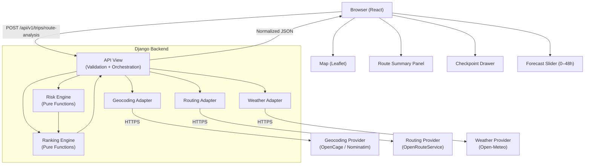

# 🛣️ Spotter.ai — Weather-Aware Truck Routing: Implementation Plan

> React + Django Full-Stack Application

---

## Overview

This plan organizes the SRS into **5 sprints (~2 weeks total)**, moving from foundational backend logic to a polished, deployed product. Each sprint builds on the prior — core risk engine first, then API, then UI, then integration, then hardening.

---

## Tech Stack Decisions

| Layer | Choice | Rationale |
|---|---|---|
| **Frontend** | React 18 + TypeScript + Vite | Fast builds, strong typing, component isolation |
| **Styling** | Tailwind CSS | Rapid responsive UI, utility-first |
| **Map** | Leaflet.js + React-Leaflet | Open-source, flexible, good heatmap plugin support |
| **Heatmap Layer** | Leaflet.heat plugin | Lightweight, sufficient for corridor heatmap |
| **State Management** | Zustand | Lightweight, suited for global route/UI state |
| **Backend** | Django 5 + Django REST Framework | Required by SRS |
| **Task Queue** | None (async w/ httpx) | Parallel provider calls via `asyncio` + `httpx` |
| **Geocoding** | OpenCage or Nominatim (OSM) | Free tier available |
| **Routing** | OpenRouteService or HERE Maps | Supports route alternatives + truck constraints |
| **Weather** | Open-Meteo (free) or Tomorrow.io | Forecast up to 7 days, forecast by coordinates |
| **Testing** | pytest (backend) + Vitest + Playwright (frontend) | Full coverage |
| **Deployment** | Railway or Render (backend) + Vercel (frontend) | Free tier, fast CI/CD |

> [!IMPORTANT]
> All provider API keys must be environment-variable only. Never committed to git.

---

## Project Structure

```
spotter-routing/
├── backend/
│   ├── spotter/                  # Django project
│   │   ├── settings/
│   │   │   ├── base.py
│   │   │   ├── dev.py
│   │   │   └── prod.py
│   │   └── urls.py
│   ├── trips/                    # Main Django app
│   │   ├── adapters/
│   │   │   ├── geocoding.py
│   │   │   ├── routing.py
│   │   │   └── weather.py
│   │   ├── engine/
│   │   │   ├── checkpoints.py    # Checkpoint + ETA generation
│   │   │   ├── risk.py           # Pure risk classification functions
│   │   │   └── ranking.py        # Route aggregation + ranking
│   │   ├── serializers.py
│   │   ├── views.py
│   │   └── tests/
│   │       ├── test_risk.py
│   │       ├── test_ranking.py
│   │       ├── test_checkpoints.py
│   │       └── test_api.py
│   ├── requirements.txt
│   └── .env.example
├── frontend/
│   ├── src/
│   │   ├── components/
│   │   │   ├── TripForm/
│   │   │   ├── MapView/
│   │   │   ├── RouteSummaryPanel/
│   │   │   ├── CheckpointDrawer/
│   │   │   └── ForecastSlider/
│   │   ├── store/                # Zustand state slices
│   │   ├── api/                  # Typed API client
│   │   ├── types/                # Shared TypeScript types
│   │   └── utils/
│   ├── tests/
│   │   ├── unit/
│   │   └── e2e/                  # Playwright
│   └── vite.config.ts
├── .github/
│   └── workflows/
│       └── ci.yml
└── README.md
```

---

## Sprint Plan

---

## 🟥 Sprint 0 — Foundation (Day 1)

**Goal:** Working repo, tooling, skeleton project, CI green.

### Tasks

- [ ] Initialize Git monorepo with `backend/` and `frontend/` directories
- [ ] Create `backend/`: Django project + DRF, virtual env, `requirements.txt`
- [ ] Create `frontend/`: Vite + React + TypeScript scaffold
- [ ] Set up `.env.example` with placeholder keys for all providers
- [ ] Configure CORS in Django for local dev (localhost:5173)
- [ ] Add GitHub Actions CI: lint + test on push
- [ ] Create `/api/v1/health/` endpoint — `{"status": "ok", "providers": {}}`
- [ ] Add `README.md` scaffold with setup instructions

### Deliverables
- Repo runs locally with `python manage.py runserver` + `pnpm dev`
- CI pipeline passes on first commit

---

## 🟧 Sprint 1 — Core Backend: Risk Engine + Checkpoint Pipeline (Days 2–4)

**Goal:** Pure, deterministic, fully-tested business logic — the heart of the application.

### 1.1 Risk Engine (`trips/engine/risk.py`)

Implement as pure functions — **zero network, zero Django imports**.

```python
# Thresholds (inclusive lower bound)
WIND_THRESHOLDS = [(55, "NO_TRAVEL"), (45, "SEVERE"), (35, "HIGH"), (25, "MODERATE"), (0, "LOW")]
RAIN_THRESHOLDS = [(1.01, "NO_TRAVEL"), (0.50, "SEVERE"), (0.25, "HIGH"), (0.10, "MODERATE"), (0, "LOW")]
SNOW_THRESHOLDS = [(3.01, "NO_TRAVEL"), (2.00, "SEVERE"), (1.00, "HIGH"), (0.50, "MODERATE"), (0, "LOW")]

def classify_wind(mph: float) -> str: ...
def classify_rain(in_per_hr: float) -> str: ...
def classify_snow(in_per_hr: float) -> str: ...
def apply_load_rules(wind_mph: float, load_lb: float, base_risk: str) -> tuple[str, list[str]]: ...
def classify_checkpoint(wind_mph, rain_in_hr, snow_in_hr, load_lb) -> dict: ...
```

**Load rules (exact per SRS §7.2):**
- Wind ≥ 55 mph → No Travel (any load)
- Wind 45–54 mph AND load > 30,000 lb → No Travel
- Wind 35–44 mph AND load > 40,000 lb → Severe

> [!NOTE]
> Load rules only **escalate**, never reduce. Risk is the max of weather classification and load escalation.

### 1.2 Checkpoint Generator (`trips/engine/checkpoints.py`)

```python
def generate_checkpoints(geometry: list[Coordinate], total_miles: float, spacing_miles: int) -> list[Checkpoint]:
    """Walk the route polyline, emit a checkpoint every spacing_miles, always include origin + destination."""

def calculate_eta(departure_ts: datetime, checkpoint_progress_ratio: float, total_duration_s: int) -> datetime:
    """ETA = departure + (progress_ratio × total_duration). Uses leg durations when available."""
```

- Checkpoints include: `checkpoint_id`, `sequence`, `distance_from_origin_miles`, `lat`, `lng`, `eta` (ISO 8601), `eta_quality` (`EXACT | INTERPOLATED`)
- Spacing: 10 / 25 / 50 miles (default 25)

### 1.3 Route Aggregation + Ranking (`trips/engine/ranking.py`)

```python
RISK_SCORE = {"LOW": 0, "MODERATE": 1, "HIGH": 2, "SEVERE": 3, "NO_TRAVEL": 4, "UNKNOWN": None}

def aggregate_route_risk(checkpoints: list) -> RiskSummary:
    """Calculate miles per risk band from segments between consecutive checkpoints."""

def rank_routes(routes: list[RichRoute]) -> list[RichRoute]:
    """
    Ranking tuple: (no_travel_flag, severe_miles, high_miles, avg_score, duration_s, route_id)
    Lexicographic sort ascending.
    """
```

> [!IMPORTANT]
> `UNKNOWN` miles are tracked separately and **never** assigned a numeric score that could inflate or deflate averages.

### 1.4 Unit Tests (`trips/tests/test_risk.py`)

Cover **every boundary value** from SRS §11 matrix:

| Condition | Boundary values to test |
|---|---|
| Wind | 24.99, 25, 34.99, 35, 44.99, 45, 54.99, 55 |
| Rain | 0.09, 0.10, 0.24, 0.25, 0.49, 0.50, 1.00, 1.01 |
| Snow | 0.49, 0.50, 0.99, 1.00, 1.99, 2.00, 3.00, 3.01 |
| Load | 30000, 30000.01, 40000, 40000.01 |

Also test: ranking order, tie-breaking by route_id, Unknown exclusion from averages.

### Sprint 1 Deliverables
- `pytest` passes all boundary + ranking tests
- No external calls in engine modules

---

## 🟨 Sprint 2 — Provider Adapters + API Endpoint (Days 5–7)

**Goal:** Real provider data flows through the backend. API endpoint returns the full normalized response shape.

### 2.1 Geocoding Adapter (`trips/adapters/geocoding.py`)

```python
async def geocode(query: str) -> GeocodedLocation:
    """Returns: lat, lng, formatted_label, confidence, provider_id"""
```

- Provider: **OpenCage** (or Nominatim as fallback)
- Caches successful results in-memory (per request session) to avoid double-geocoding
- Maps provider errors → `GEOCODING_FAILED` application error

### 2.2 Routing Adapter (`trips/adapters/routing.py`)

```python
async def get_routes(origin: Coordinate, destination: Coordinate, alternatives: int = 3) -> list[Route]:
    """Returns normalized routes: route_id, geometry (polyline), distance_miles, duration_seconds, legs, attribution"""
```

- Provider: **OpenRouteService** (free, supports alternatives + truck mode)
- Normalize: convert km → miles, decode geometry from polyline encoding
- Map provider errors → stable error codes (`ROUTING_PROVIDER_UNAVAILABLE`, `NO_ROUTE_FOUND`, etc.)
- 10s timeout, 2 retries with exponential backoff (non-retryable errors excluded)

### 2.3 Weather Adapter (`trips/adapters/weather.py`)

```python
async def get_forecasts(checkpoints: list[CheckpointWithETA]) -> list[WeatherSnapshot]:
    """Batch or parallel-fetch forecast for each (lat, lng, eta_timestamp). Returns normalized wind/rain/snow."""
```

- Provider: **Open-Meteo** (free, hourly forecast, no API key required → great for demo)
- Normalize units to mph + in/hr before returning
- Mark out-of-horizon checkpoints as `UNKNOWN` with a reason string
- Parallelize with `asyncio.gather()` up to 10 concurrent calls
- Cache by (lat, lng, hour bucket) within a request

### 2.4 Main API View (`trips/views.py`)

```
POST /api/v1/trips/route-analysis
```

**Orchestration pipeline:**
```
validate_input()
  → geocode(origin), geocode(destination)   [parallel]
  → get_routes(origin_coord, dest_coord)
  → generate_checkpoints(routes, spacing)
  → get_forecasts(all_checkpoints)           [batched/parallel]
  → classify_checkpoint(weather, load)       [for each checkpoint]
  → aggregate_route_risk(routes)
  → rank_routes(routes)
  → build_response()
```

**Request validation (DRF Serializer):**
- `origin.query`: required, non-empty string
- `destination.query`: required, non-empty string
- `departure_at`: required ISO 8601 with timezone
- `load_weight_lb`: required, ≥ 0, numeric
- `checkpoint_spacing_miles`: optional, one of `[10, 25, 50]`, default 25

**Error response shape** (all errors):
```json
{
  "error": {
    "code": "ROUTING_PROVIDER_UNAVAILABLE",
    "message": "Routes are temporarily unavailable. Please retry.",
    "request_id": "uuid",
    "retryable": true,
    "details": []
  }
}
```

> [!CAUTION]
> Never return provider error bodies, raw exceptions, or stack traces to the client. Log them server-side with request_id.

### 2.5 Integration Tests

- Adapter normalization (mock provider responses)
- Provider error → application error mapping
- Endpoint schema validation (happy path + all error codes)
- Response shape matches SRS §9.2 contract

### Sprint 2 Deliverables
- `curl` to `/api/v1/trips/route-analysis` with Denver→Chicago returns valid 3-route response
- All integration tests pass with mocked providers

---

## 🟩 Sprint 3 — React Frontend (Days 8–11)

**Goal:** Complete UI matching the SRS UX requirements — form, map, route panels, checkpoint drawer, forecast slider.

### 3.1 TypeScript Types (`src/types/`)

Mirror the API response shape exactly:

```typescript
type RiskLevel = "LOW" | "MODERATE" | "HIGH" | "SEVERE" | "NO_TRAVEL" | "UNKNOWN";

interface Checkpoint {
  checkpoint_id: string;
  distance_from_origin_miles: number;
  latitude: number;
  longitude: number;
  eta: string;           // ISO 8601
  weather: WeatherData;
  risk: RiskAssessment;
}

interface Route {
  route_id: string;
  distance_miles: number;
  duration_seconds: number;
  risk_summary: RiskSummary;
  ranking: { tuple: [number, number, number, number, number, string] };
  checkpoints: Checkpoint[];
}

interface RouteAnalysisResponse {
  request_id: string;
  recommended_route_id: string;
  routes: Route[];
  warnings: string[];
  provider_metadata: Record<string, string>;
}
```

### 3.2 Zustand Store (`src/store/`)

```typescript
// tripStore.ts
interface TripState {
  status: "idle" | "loading" | "success" | "error";
  loadingPhase: "geocoding" | "routing" | "weather" | "analysis" | null;
  result: RouteAnalysisResponse | null;
  error: ApiError | null;
  selectedRouteId: string | null;
  selectedCheckpointId: string | null;
  forecastHourOffset: number;          // 0–48
  submitTrip: (form: TripFormData) => Promise<void>;
  selectRoute: (id: string) => void;
  setForecastHour: (hour: number) => void;
}
```

### 3.3 Component Plan

#### `TripForm` (FR-001 to FR-008)
- Fields: Origin (text + autocomplete), Destination, Departure datetime-local, Load weight (lb), Checkpoint spacing (10/25/50 select)
- Client-side validation: all required, weight ≥ 0, datetime with timezone
- Submit button disabled + error field highlights on invalid state
- Shows departure timezone resolved from origin

#### `MapView` (FR-060 to FR-067)
- Leaflet map, auto-fit bounds to all routes on load
- Route polylines: distinct colors per route, thicker + highlighted for recommended/selected
- Checkpoint markers: color-coded by risk level (Green/Amber/Orange/Red/DarkRed/Gray)
  - Click → opens `CheckpointDrawer`
- Weather heatmap layer using `leaflet.heat` driven by `forecastHourOffset` state
- Provider attribution visible per Leaflet + provider terms
- Degrades gracefully: if heatmap plugin fails, show message; routes still render

#### `RouteSummaryPanel` (FR-050 to FR-056)
- Card per route: name, distance, duration, risk miles breakdown (color-coded bars), overall risk badge
- Recommended route: star badge + "Recommended" label
- Active selected route: highlighted border
- No Travel routes: dark red warning block
- Click → selects route (updates map highlight, does not change recommendation)

#### `CheckpointDrawer` (FR-062)
- Slide-in drawer / modal on checkpoint or route selection
- Shows: ETA, forecast time, wind/rain/snow values + units, risk level badge, load rule explanation, data source
- `UNKNOWN` shown in gray with "Forecast unavailable" message

#### `ForecastSlider` (FR-063 to FR-065)
- Range input: 0–48 hours (step 1)
- Shows effective timestamp (departure + offset, formatted with timezone)
- Updates heatmap data layer without page reload
- Label clarifies forecast resolution limitations

### 3.4 Visual Semantics Implementation

```typescript
const RISK_COLORS: Record<RiskLevel, { bg: string; text: string; label: string }> = {
  LOW:        { bg: "#16a34a", text: "white",   label: "Low" },
  MODERATE:   { bg: "#d97706", text: "white",   label: "Moderate" },
  HIGH:       { bg: "#ea580c", text: "white",   label: "High" },
  SEVERE:     { bg: "#dc2626", text: "white",   label: "Severe" },
  NO_TRAVEL:  { bg: "#7f1d1d", text: "white",   label: "No Travel" },
  UNKNOWN:    { bg: "#6b7280", text: "white",   label: "Unknown" },
};
```

> [!WARNING]
> Risk must never be communicated by color alone. Every marker and badge must include a text label and/or icon for accessibility (WCAG 2.1 AA).

### 3.5 Loading & Error States

| Phase | UI Treatment |
|---|---|
| Geocoding | "Resolving locations…" skeleton |
| Routing | "Finding route alternatives…" skeleton |
| Weather | "Fetching weather forecasts…" skeleton with checkpoint count |
| Analysis | "Calculating risk…" spinner overlay on map |
| Error | Alert banner with message, correlation ID (request_id), and Retry button |
| Empty | "Enter a trip above to see route recommendations" placeholder |

### Sprint 3 Deliverables
- Full UI renders with mocked API data
- All loading/error/empty states visible
- Map shows routes, markers, heatmap
- Checkpoint drawer opens with full details

---

## 🔵 Sprint 4 — Integration, Testing & Accessibility (Days 12–14)

**Goal:** Wire frontend to live backend, complete test coverage, accessibility audit.

### 4.1 API Client (`src/api/client.ts`)

```typescript
export async function analyzeRoute(form: TripFormData): Promise<RouteAnalysisResponse> {
  const response = await fetch(`${API_BASE}/api/v1/trips/route-analysis`, {
    method: "POST",
    headers: { "Content-Type": "application/json" },
    body: JSON.stringify(form),
  });
  if (!response.ok) {
    const err = await response.json();
    throw new ApiError(err.error);
  }
  return response.json();
}
```

### 4.2 E2E Tests (Playwright)

| Test Case | Covers |
|---|---|
| Submit Denver→Chicago (load 42000) → 3 routes appear | AC-001 |
| Checkpoint with 35mph wind + 42000lb load → Severe + load rule shown | AC-002 |
| 50mph wind + 31000lb → No Travel shown | AC-003 |
| Slider moves → heatmap timestamp updates | AC-010 |
| Routing provider error → error UI + retry button | AC-011 |
| No provider keys in network responses | AC-012 |

### 4.3 Component Tests (Vitest + Testing Library)

- `TripForm`: all validation paths, submit blocked when invalid
- `RouteSummaryPanel`: recommendation badge, No Travel warning block
- `ForecastSlider`: timestamp display at 0h and 48h
- `CheckpointDrawer`: Unknown weather shows gray label (not Low)

### 4.4 Accessibility Audit

- [ ] All form fields have `<label>` associations
- [ ] Map has `aria-label` describing routes; textual route summary is keyboard-reachable
- [ ] Risk badges include `aria-label="Risk level: No Travel — wind 55 mph"`
- [ ] Slider has `aria-valuetext` showing effective timestamp
- [ ] Color contrast ≥ 4.5:1 for all risk labels
- [ ] No Travel trigger reason read by screen readers

### 4.5 Backend Performance

- [ ] Verify parallel weather fetching with `asyncio.gather()`
- [ ] Test p95 < 10s for 25-mile spacing on a 1000-mile route (≈40 checkpoints, 3 routes = 120 weather calls)
- [ ] Add request timeout: 15s overall, 8s per provider call

### Sprint 4 Deliverables
- All acceptance criteria (AC-001 to AC-012) have passing tests
- Full boundary test matrix passes
- Accessibility: no critical violations

---

## 🟣 Sprint 5 — Deployment, Hardening & Walkthrough (Days 15–16)

**Goal:** Live hosted app, secure config, README, walkthrough video.

### 5.1 Deployment

**Backend (Railway or Render):**
```
DJANGO_SECRET_KEY=...
GEOCODING_API_KEY=...
ROUTING_API_KEY=...
WEATHER_API_KEY=...
ALLOWED_HOSTS=your-backend.railway.app
CORS_ALLOWED_ORIGINS=https://your-frontend.vercel.app
DEBUG=False
```

**Frontend (Vercel):**
```
VITE_API_BASE_URL=https://your-backend.railway.app
```

### 5.2 Security Hardening

- [ ] `DEBUG=False` in prod; 500 errors → generic JSON response
- [ ] CORS locked to frontend domain only
- [ ] CSRF token required for POST endpoints
- [ ] Rate limiting on `/api/v1/trips/route-analysis` (e.g., 30 req/min via `django-ratelimit`)
- [ ] Audit: no provider keys in client bundle, logs, or API responses (AC-012)
- [ ] TLS enforced for all outbound provider calls

### 5.3 Health & Observability

```
GET /api/v1/health/
→ { "status": "ok", "providers": { "geocoding": "reachable", "routing": "reachable", "weather": "reachable" } }
```

- Log format: `[request_id] [phase] [level] message` — no addresses, no secrets
- Metrics: request count, provider latency, weather coverage ratio

### 5.4 Documentation

**README.md must include:**
- [ ] Architecture diagram (Mermaid or ASCII)
- [ ] Local setup steps (backend + frontend)
- [ ] `.env.example` explanation (all variables)
- [ ] Provider signup links + free tier limits
- [ ] `pytest` + `pnpm test` commands
- [ ] Deployment guide
- [ ] Known limitations (forecast horizon, provider quota, no turn-by-turn)
- [ ] Safety disclaimer text

### 5.5 Walkthrough Script (5–10 min)

1. **Input** (1 min): Enter Denver → Chicago, departure tomorrow 8am, 42,000 lb, 25-mile spacing
2. **Loading states** (30 sec): Show geocoding → routing → weather phases
3. **Route comparison** (2 min): Three routes visible, recommendation highlighted with rationale
4. **Checkpoint detail** (1.5 min): Click a Severe checkpoint, show ETA, wind value, load rule reason
5. **Heatmap slider** (1 min): Drag 0→24→48h, show timestamp update and heatmap change
6. **Error state** (1 min): Disable network or enter invalid address, show error + retry
7. **No Travel scenario** (30 sec): Enter high-wind scenario, show blocking No Travel warning

### Sprint 5 Deliverables
- Hosted app accessible via public URL
- No secrets in any client-facing channel
- README covers all setup/config/test paths
- Walkthrough recorded or ready to present

---

## Architecture Diagram



---

## Risk Table

| Risk | Mitigation |
|---|---|
| Open-Meteo rate limits with 120+ concurrent calls | Batch by location proximity; cache by (lat, lng, hour) bucket |
| OpenRouteService returns < 3 alternatives | Show available count, don't fabricate routes (FR-013) |
| Forecast horizon < trip duration | Mark checkpoints `UNKNOWN`, surface warning (FR-034, FR-047) |
| Complex polyline interpolation bugs | Unit test checkpoint generator with known polylines |
| Map rendering slow with many markers | Cluster markers when zoomed out; simplify geometry |
| Deployment secrets leak | CI check: scan bundle for key patterns before deploy |

---

## Decisions to Make Before Sprint 2

> [!IMPORTANT]
> These affect the implementation directly and should be resolved before coding adapters.

1. **Threshold boundary policy** — use inclusive lower bound as stated in `§7.1` boundary policy section (recommended)
2. **No Travel as leading ranking gate** — treat No Travel exposure as a hard flag before lexicographic sort (recommended)
3. **Unknown ranking policy** — recommended: routes with Unknown segments rank below equivalent fully-observed routes
4. **Provider selection** — confirm: OpenRouteService (routing), Open-Meteo (weather), OpenCage (geocoding)
5. **No Travel in average score** — recommended: exclude from numeric average, track separately

---

## Definition of Done Checklist

- [ ] All **Must** requirements implemented (FR-001 through FR-072)
- [ ] All P0 + P1 implementation priorities complete
- [ ] `pytest` passes: boundary matrix, ranking, checkpoint ETAs, adapter normalization
- [ ] Playwright E2E: all 12 acceptance criteria have a passing test
- [ ] No provider keys visible in client bundle, logs, or API responses
- [ ] Hosted deployment responds to health check
- [ ] README covers local setup, env vars, tests, and limitations
- [ ] Walkthrough demonstrates happy path + degraded path in ≤ 10 minutes
- [ ] Product owner has approved open decisions affecting classification and ranking
